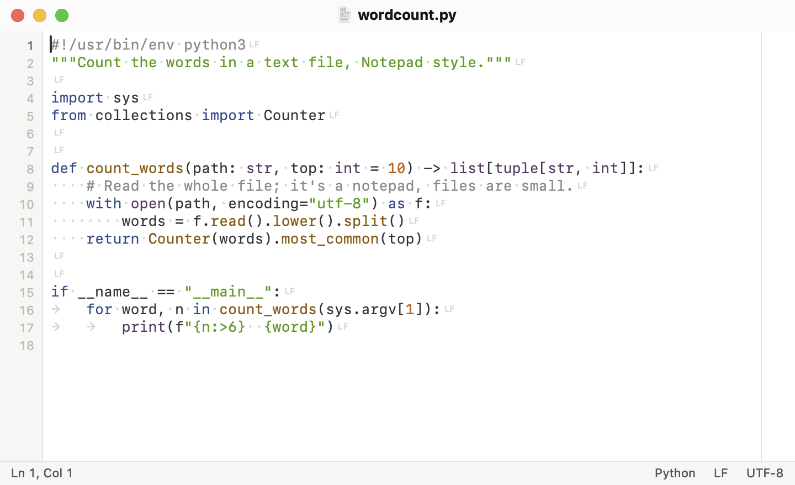
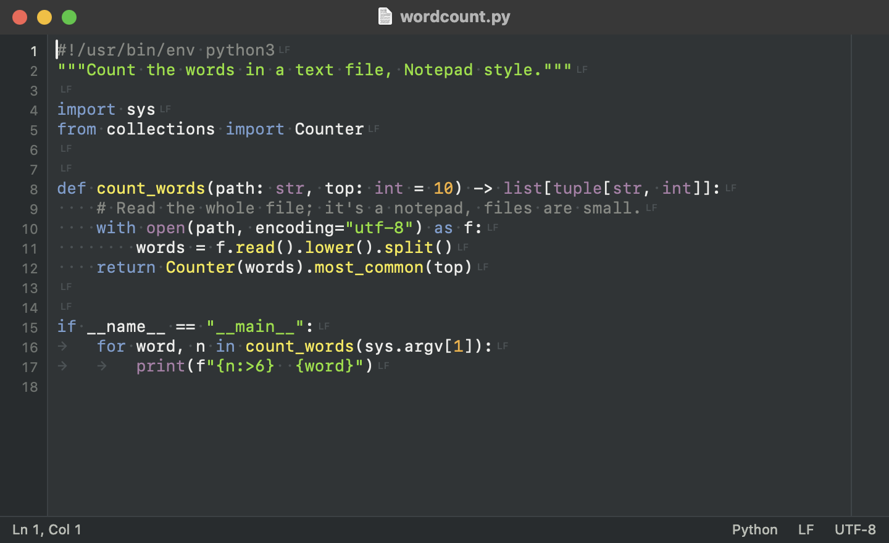

# Notepad

A plain, Windows XP Notepad–style text editor for macOS: one window per file, no tabs, no sidebar, no project anything. Native Swift/AppKit, no dependencies, ~700 KB app.

**Why?** Years of muscle memory: hit the Start menu, type "notepad", press Enter. On a Mac that became ⌘Space, "notepad", Enter, and nothing useful came up. Now something does.

Derived from [LiteEdit](https://github.com/arietan/lite-edit) (MIT): the syntax highlighter and line-number gutter started there. Everything else was stripped out.

> **Heads up: this is vibe coded.** It was written mostly by an AI coding assistant, with me steering and testing it for my own daily use. It works for me, but it hasn't been audited or battle-tested. Use it at your own risk, keep backups of anything important, and see the [LICENSE](LICENSE): no warranty of any kind.

| Light | Dark |
|---|---|
|  |  |

## Download

Grab `Notepad-<version>.zip` from the [latest release](https://github.com/xubz/notepad/releases/latest), unzip it, and drag `Notepad.app` to `/Applications`. It's signed with a Developer ID and notarized by Apple, so it opens normally. Requires macOS 13+ on Apple Silicon.

## Features

- **File:** New, Open…, Save, Save As… (any extension), Close, Exit. Prompts to save unsaved changes.
- **Edit:** Undo/Redo, Cut/Copy/Paste, Find…, Find Next/Previous, Replace…, Go to Line…
- **Format:** Word Wrap, Font… (default: system monospace, SF Mono), Line Endings, Encoding, Syntax
- **View:** Line Numbers, Status Bar, Show Whitespace & Line Endings (on by default), Column Guide (off / 72 / 80 / 100 / 120), Zoom In/Out
- **Status bar:** `Ln, Col`, plus clickable Syntax, Line Ending and Encoding fields that change them directly
- **Always starts empty:** launching opens a blank Untitled window and never restores last session's files
- **Syntax highlighting** with the Tango palette, following system Light/Dark mode. Languages: C/C++, CSS, Go, HTML, INI, Java, JS/TS, JSON, Markdown, Python, Ruby, Rust, Shell, SQL, Swift, TOML, XML, YAML. Detected from the file extension or shebang line.
- **Files are saved exactly as they came in.** The line endings (LF / CRLF / CR) and encoding (UTF-8, UTF-8 BOM, UTF-16 LE/BE, Windows-1252, Latin-1) are detected on open and kept on save. You can convert either from the Format menu. Files with *mixed* line endings show `(mixed)` in the status bar and are saved with the most common one. Pasted text is converted to the file's line ending.
- **Visible whitespace:** `·` space, `→` tab, `°` non-breaking space, and a faint `LF`/`CRLF`/`CR` tag at each line end.

## Build

Requires macOS 13+ and Swift 5.9+ (Xcode or the Command Line Tools).

```sh
./build.sh            # builds builds/<version>/Notepad.app (version from Resources/Info.plist)
./build.sh --install  # …and copies it to /Applications
open builds/1.0/Notepad.app
```

Local builds are ad-hoc signed. To build a signed, notarized release zip (needs a Developer ID certificate and a `notarytool store-credentials` profile):

```sh
SIGN_IDENTITY="Developer ID Application: Your Name (TEAMID)" NOTARY_PROFILE=notary ./build.sh
# → builds/<version>/Notepad.app and builds/<version>/Notepad-<version>.zip
```

## Shortcuts

| Action | Keys | Action | Keys |
|---|---|---|---|
| New | ⌘N | Find | ⌘F |
| Open | ⌘O | Find Next / Previous | ⌘G / ⇧⌘G |
| Save | ⌘S | Replace | ⌥⌘F |
| Save As | ⇧⌘S | Use Selection for Find | ⌘E |
| Close | ⌘W | Go to Line | ⌘L |
| Font | ⌘T | Show Whitespace | ⌥⌘I |
| Zoom In / Out / Reset | ⌘= / ⌘- / ⌘0 | Quit | ⌘Q |
